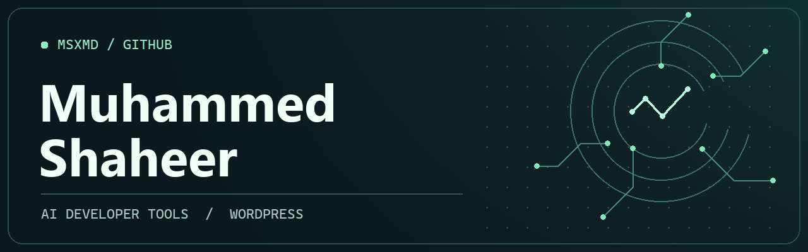

I build tools for AI-assisted development and WordPress. My projects focus on making everyday work easier to resume, debug, and maintain.

[MSXMD website](https://msxmd.com/) · [All public repositories](https://github.com/shaheer-00?tab=repositories)

## Selected projects

| Project | What it does |
| :--- | :--- |
| [**claude-adhd**](https://github.com/shaheer-00/claude-adhd) | Brings unfinished threads from earlier Claude Code sessions back into view so you can pick up where you left off. |
| [**switchXprovider**](https://github.com/shaheer-00/switchXprovider) | Routes Claude Code requests through a local multi-provider proxy with failover and usage tracking. |
| [**fixdex**](https://github.com/shaheer-00/fixdex) | Stores recurring errors and their fixes in local SQLite so Claude Code can recall a fix when the same error comes back. |
| [**MSXMD Toolkit**](https://github.com/shaheer-00/msxmd-toolkit) | A modular WordPress plugin for admin styling, login branding, and site maintenance. |
