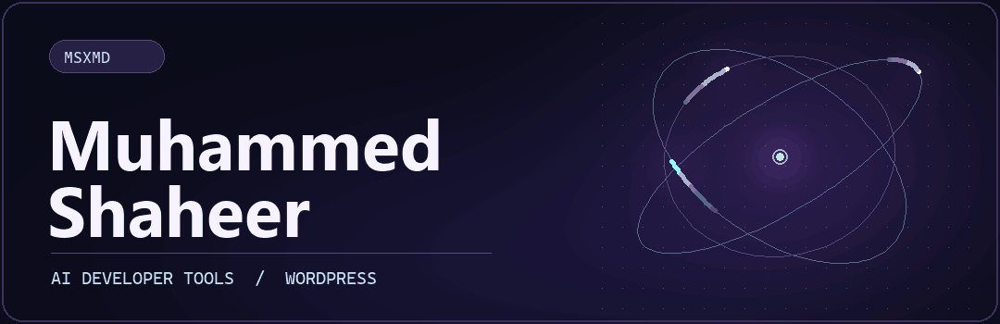
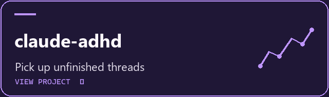
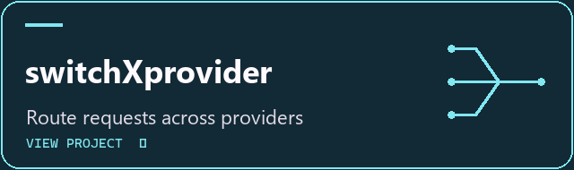
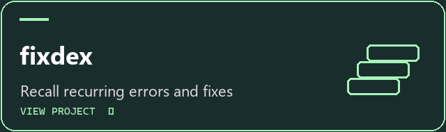
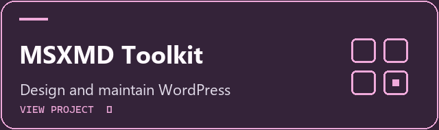

<picture>
  <source media="(prefers-reduced-motion: reduce)" srcset="assets/banner.png">
  
</picture>

I build tools that help developers pick up interrupted work, reuse fixes, and keep their workflows running.

[**MSXMD**](https://msxmd.com/) · [**Public repositories**](https://github.com/shaheer-00?tab=repositories)

<!-- repo-counts:start -->
**16 public** · **12 private**
<!-- repo-counts:end -->

## Open-source projects

<table>
  <tr>
    <td width="50%"></td>
    <td width="50%"></td>
  </tr>
  <tr>
    <td width="50%"></td>
    <td width="50%"></td>
  </tr>
</table>
